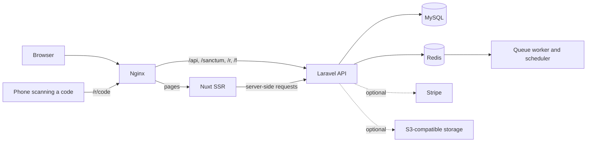

# Qrio

**Create, customise and track QR codes that make every scan count.**

Qrio is a self-hostable QR code SaaS. It combines a free public generator with dynamic codes you can edit after printing, scan analytics, team workspaces, Stripe subscriptions and a full admin panel.

**Live site:** [qr.hivelabsbd.com](https://qr.hivelabsbd.com)


## Contents

- [Features](#features)
- [Supported QR types](#supported-qr-types)
- [Architecture](#architecture)
- [Tech stack](#tech-stack)
- [Quick start](#quick-start)
- [Configuration](#configuration)
- [Billing with Stripe](#billing-with-stripe)
- [Deployment](#deployment)
- [Rebranding](#rebranding)
- [Testing](#testing)
- [Project structure](#project-structure)
- [Contributing](#contributing)
- [License](#license)

## Features

### QR codes

- **Static and dynamic codes.** Change a dynamic code's destination at any time without reprinting it, with a full change history.
- **Design controls.** Set colours, transparent backgrounds, dot and corner styles, error correction, margins, frames with labels, and a centre logo.
- **Downloads.** Export as PNG, SVG or PDF.
- **Hosted landing pages.** Serve PDFs, link lists, social profiles, business cards, contacts and app links from your own domain.
- **Organisation.** Group codes with folders and campaigns, and use bulk actions, duplication and pause or archive.

### Analytics

- Total and unique scans, plus device, OS, browser, country and referrer breakdowns.
- Bot filtering, with per-code and per-campaign views and CSV export.
- **Privacy-reduced tracking.** Raw IP addresses never reach the queue. Unique scans are estimated from a salted hash that rotates daily.
- Raw scan events are pruned after a configurable window (90 days by default), while daily aggregates are kept.

### Accounts and billing

- Registration, email verification, password reset and team invitations.
- Plans with enforced limits on codes, scans, storage, upload size, team seats and features.
- Stripe Checkout, the billing portal, trials, coupons, invoices, refunds and a grace period for lapsed accounts.

### Admin panel

- Overview dashboard, customers, per-customer quota overrides and manual plan grants.
- Plan, price and coupon management, plus payments and webhook event replay.
- Moderation of QR codes and abuse reports, and storage overview.
- CMS for FAQs, legal pages and email templates, plus the contact inbox.
- Roles and granular permissions, system settings and an audit log.

### Security and SEO

- Destination checks that reject non-web schemes, private network addresses and redirect loops through the short domain.
- Rate limits on auth, uploads, code creation, redirects and public forms. SVG logo uploads are rejected because they can carry scripts.
- Server-rendered marketing pages with a sitemap, `robots.txt` and schema.org data. Private routes are never indexed.

## Supported QR types

| Type | Static | Dynamic | Hosted page |
| --- | :---: | :---: | :---: |
| URL | ✓ | ✓ | |
| Contact (vCard) | ✓ | ✓ | ✓ |
| App download | ✓ | ✓ | ✓ |
| PDF | | ✓ | ✓ |
| Multiple links | | ✓ | ✓ |
| Social profiles | | ✓ | ✓ |
| Business card | | ✓ | ✓ |
| Plain text | ✓ | | |
| SMS | ✓ | | |
| Email | ✓ | | |
| Phone | ✓ | | |
| Wi-Fi | ✓ | | |

## Architecture



The browser only talks to one origin. Sanctum handles authentication with session cookies. Without Nginx in front, for example on shared hosting, the Nuxt server proxies `/api`, `/sanctum`, `/r` and `/f` to Laravel itself.

A scan takes a fast path: `/r/{code}` runs without session middleware, returns the redirect, and records the scan through a queued job.

## Tech stack

| Layer | Technology |
| --- | --- |
| Frontend | Nuxt 4, Vue 3, TypeScript, Tailwind CSS 4, Motion |
| QR rendering | `qr-code-styling`, `jsPDF` |
| Backend | Laravel 12, PHP 8.2+, Sanctum |
| Database | SQLite for local development, MySQL 8 in production |
| Queue and cache | Database drivers locally, Redis in production |
| Payments | Stripe |
| File storage | Local disk or any S3-compatible service |
| Infrastructure | Docker Compose, Nginx |

## Quick start

**Prerequisites:** PHP 8.2+ with the `sqlite3` and `intl` extensions, Composer 2, and Node.js 24. On Windows, run these commands in Git Bash.

### 1. Clone the repository

```bash
git clone https://github.com/ftayebee/qrlabsbd.git
```

```bash
cd qrlabsbd
```

### 2. Start the API

```bash
cd backend
composer install
cp .env.example .env
php artisan key:generate
touch database/database.sqlite
```

Add your first admin account to `backend/.env`. No default credentials are shipped, so without these values no admin user is created.

```dotenv
ADMIN_EMAIL=you@example.com
ADMIN_PASSWORD=choose-a-strong-password

# Optional: a sample customer with codes and simulated scans (local only)
SEED_DEMO_DATA=true
DEMO_PASSWORD=choose-a-demo-password
```

Then create the database and start the server:

```bash
php artisan migrate --seed
```

```bash
php artisan serve
```

The API now runs on `http://127.0.0.1:8000`. The demo customer signs in as `demo@example.test`.

Scans and queued mail need a worker, so run this in a second terminal:

```bash
php artisan queue:work --queue=billing,analytics,default
```

In local development, email is written to `storage/logs/laravel.log` rather than sent. That includes verification links.

### 3. Start the frontend

In a new terminal, from the repository root:

```bash
cd frontend
cp .env.example .env
npm ci
npm run dev
```

Open `http://localhost:3000`. The admin panel is at `/admin`.

## Configuration

### Frontend (`frontend/.env`)

| Variable | Purpose |
| --- | --- |
| `NUXT_PUBLIC_SITE_URL` | Public URL of the site, used for canonical URLs and the sitemap |
| `NUXT_PUBLIC_SHORT_DOMAIN` | Domain encoded into dynamic QR codes. It must route `/r/*` to Laravel |
| `NUXT_API_INTERNAL_URL` | How the Nuxt server reaches Laravel. A trailing `/api` is handled |

### Backend (`backend/.env`)

`backend/.env.example` covers the standard Laravel settings. These are specific to Qrio, and most of them are not in the example file, so add the ones you need:

| Variable | Default | Purpose |
| --- | --- | --- |
| `FRONTEND_URL` | `http://localhost:3000` | Frontend origin, used for links in email and as a Sanctum stateful domain |
| `QRIO_SHORT_DOMAIN` | `FRONTEND_URL` | Domain encoded into dynamic QR codes |
| `QRIO_BRAND_NAME` | `Qrio` | Product name in emails |
| `QRIO_SUPPORT_EMAIL` | | Support address in emails |
| `QRIO_FILES_DISK` | `local` | Disk for PDFs and logos. Use `s3` in production, with the `AWS_*` values set |
| `QRIO_UPLOAD_HARD_MAX_KB` | `51200` | Upload ceiling that applies regardless of plan |
| `ADMIN_EMAIL`, `ADMIN_PASSWORD` | | First super admin, created by the seeder |
| `SEED_DEMO_DATA`, `DEMO_PASSWORD` | | Demo data, which only runs when `APP_ENV=local` |
| `STRIPE_SECRET`, `STRIPE_WEBHOOK_SECRET` | | Stripe API key and webhook signing secret |
| `BILLING_CURRENCY` | `USD` | Default billing currency |
| `BILLING_GRACE_DAYS` | `14` | Days a lapsed account keeps full access |
| `ANALYTICS_RAW_RETENTION_DAYS` | `90` | How long raw scan events are kept |
| `ANALYTICS_COUNTRY_HEADER` | `CF-IPCountry` | Header holding the visitor's ISO country code, set by your CDN or proxy |
| `ANALYTICS_REGION_HEADER` | | Header holding the visitor's region |
| `REDIRECT_CACHE_TTL` | `3600` | Seconds a redirect target stays cached |
| `REDIRECT_BLOCKED_HOSTS` | | Comma-separated hostnames that can't be used as destinations |

Country analytics depend on `ANALYTICS_COUNTRY_HEADER`. Without a CDN or proxy that sets it, scans have no country.

## Billing with Stripe

Stripe is optional. Without it, the free plan works and admins can grant plans by hand from the admin panel.

To enable paid plans:

1. Set `STRIPE_SECRET` in `backend/.env`.
2. In Stripe, add a webhook endpoint for `https://your-domain/api/v1/webhooks/stripe`.
3. Subscribe the endpoint to these events, then set `STRIPE_WEBHOOK_SECRET` to its signing secret:
   - `checkout.session.completed`
   - `customer.subscription.created`, `.updated`, `.deleted` and `.trial_will_end`
   - `invoice.paid`, `.payment_succeeded`, `.payment_failed`, `.finalized`, `.voided` and `.marked_uncollectible`
   - `charge.refunded`

The seeder creates four plans as a starting point. The prices are placeholders, so review them under **Admin → Plans**.

| Plan | Price | Dynamic codes | Scans per month | Team members |
| --- | --- | --- | --- | --- |
| Free | $0 | 2 | 1,000 | 0 |
| Pro | $12/month | 50 | 50,000 | 2 |
| Business | $39/month | 500 | 500,000 | 10 |
| Enterprise | Custom | Custom | Custom | Custom |

## Deployment

### Docker Compose

The stack runs Nginx, Nuxt, Laravel (PHP-FPM), a queue worker, a scheduler, MySQL 8.4 and Redis 7.4.

**1. Set the stack's values.** Copy the template, then fill in the URLs and passwords:

```bash
cp .env.docker.example .env.docker
```

**2. Create `backend/.env.production`.** Compose requires this file, and there is no template for it yet. Start from this, adding any settings from [Configuration](#configuration) that you need:

```dotenv
APP_NAME=Qrio
APP_ENV=production
APP_DEBUG=false
APP_KEY=
APP_URL=https://your-domain
FRONTEND_URL=https://your-domain
QRIO_SHORT_DOMAIN=https://your-domain

DB_CONNECTION=mysql
CACHE_STORE=redis
QUEUE_CONNECTION=redis
SESSION_DRIVER=redis
REDIS_CLIENT=phpredis

ADMIN_EMAIL=you@example.com
ADMIN_PASSWORD=choose-a-strong-password
```

Generate a value for `APP_KEY` with this command, and paste in the whole output:

```bash
echo "base64:$(openssl rand -base64 32)"
```

**3. Start the stack and set up the database.** Migrations don't run automatically:

```bash
docker compose --env-file .env.docker up -d --build
```

```bash
docker compose --env-file .env.docker exec api php artisan migrate --seed --force
```

**Before going to production:**

- **Outbound access.** The `api` and `queue` services are only on the `internal` network, which has no internet access. Stripe, SMTP and S3 calls will fail until you also attach those services to a network with outbound access, such as `edge`.
- **TLS.** Nginx listens on plain HTTP only. Terminate TLS at a load balancer or add it to `docker/nginx/default.conf`.

### Shared hosting or separate Node and PHP hosts

Qrio also runs without Docker:

1. **Frontend.** Deploy `frontend/` as a Node app, using `npm run build` and starting `node .output/server/index.mjs`. Set `NUXT_API_INTERNAL_URL` to the API's URL.
2. **Backend.** Deploy `backend/` to a PHP host with the document root set to `public/`. Run `composer install --no-dev` and `php artisan migrate --seed --force`.
3. **Cron.** Add this job, running every minute. It runs scheduled tasks and drains the queue, so no long-running worker is needed:

   ```bash
   php artisan schedule:run
   ```

## Rebranding

The product name, tagline, colours, support email and social links are all in [`frontend/app/brand.config.ts`](frontend/app/brand.config.ts). If you change the colours, update the matching tokens in [`frontend/app/assets/css/main.css`](frontend/app/assets/css/main.css) too. Set `QRIO_BRAND_NAME` and `QRIO_SUPPORT_EMAIL` for email.

## Testing

Backend tests cover authentication, QR codes, redirects, billing and the admin panel. They use a fake Stripe gateway, so no API key is needed.

```bash
cd backend && php artisan test
```

Frontend tests cover QR payload encoding:

```bash
cd frontend && npm test
```

## Project structure

```text
.
├── backend/                 Laravel API
│   ├── app/Http/            Controllers, middleware and form requests
│   ├── app/Services/        Analytics, billing, files and QR logic
│   ├── config/qrio.php      Product configuration
│   ├── database/            Migrations and seeders
│   ├── routes/              API, redirect and scheduler definitions
│   └── tests/               Feature and unit tests
├── frontend/                Nuxt app
│   ├── app/brand.config.ts  Brand identity
│   ├── app/components/      Marketing, dashboard, QR and UI components
│   ├── app/pages/           Public, dashboard and admin routes
│   └── server/              Proxy routes to Laravel and the sitemap source
├── docker/                  Dockerfiles and Nginx configuration
├── docker-compose.yml       Production-oriented stack
└── .env.docker.example      Template for the Compose values
```

## Contributing

Issues and pull requests are welcome. For larger changes, open an issue first so the approach can be discussed.

1. Fork the repository and create a branch from `main`.
2. Add tests for your change where they apply.
3. Make sure `php artisan test` and `npm test` both pass.
4. Open a pull request describing what changed and why.

Please don't report security vulnerabilities in public issues. Contact the maintainer through [GitHub](https://github.com/ftayebee) instead.

## License

No license has been added to this repository yet. Until a `LICENSE` file is present, default copyright applies.
